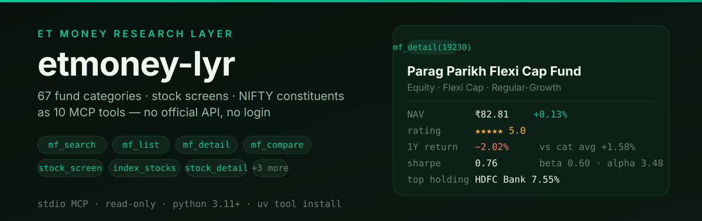
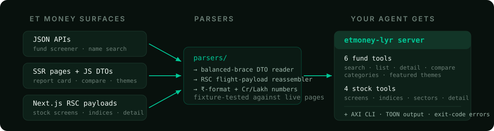

<!-- T2I HERO SPEC — Subject: split hero. Left: "etmoney-lyr" wordmark over dark green-slate, eyebrow "ET MONEY RESEARCH LAYER", one-line promise, 7 pill chips naming MCP tools, metadata row (stdio · read-only · python 3.11+). Right: a real fund report-card module titled mf_detail(19230) showing NAV ₹82.81, ★5 rating, 1Y −2.02% vs category +1.58%, Sharpe 0.76, top holding HDFC Bank 7.55% in mono rows. Palette: bg #08110d→#0b1a14, accent #00c896, amber #ffb224, muted #6b7f76. Style: flat fintech research terminal, no text-free decoration, 16:9-ish. -->

<p align="center">
  
</p>

<h1 align="center">etmoney-lyr</h1>

<p align="center">
  <a href="https://github.com/ishan-parihar/etmoney-lyr/actions/workflows/ci.yml"></a>
  
  
  
  
</p>

**ET Money has no public API. Your agent wants one.** `etmoney-lyr` reverse-engineers
[ET Money](https://www.etmoney.com)'s research surfaces into a local MCP server:
all **67 mutual-fund categories**, stock market screens, NIFTY index and sector
constituents — served as **10 typed tools** with structured JSON output.
Read-only, no login, no keys.

---

## See it work

A real session, real numbers, straight from the tools:

```jsonc
// mf_search {"query": "parag parikh"}
{ "total": 7, "results": [ { "scheme_id": 19230, "name": "Parag Parikh Flexi Cap Fund Regular-Growth", ... } ] }

// mf_detail {"scheme_id": 19230}
{
  "name": "Parag Parikh Flexi Cap Fund Regular-Growth",
  "riskometer": "Very High",
  "nav": 82.81,
  "expense_ratio_total_pct": 1.29,
  "trailing_returns": [ { "period": "1 Year", "fund_pct": -2.02, "category_avg_pct": 1.58 }, "...9 more horizons" ],
  "holdings":        [ { "name": "HDFC Bank Ltd.", "bucket": "EQUITY", "pct": 7.55 }, "...84 more" ],
  "sectors":         [ { "name": "Financial", "pct": 25.69 }, "...17 more" ],
  "risk_ratios_fund":     { "sharpeRatio": 0.76, "beta": 0.60, "alpha": 3.48 },
  "risk_ratios_category": { "sharpeRatio": 3.54, "beta": 0.57 },
  "managers": [ "Raj Mehta", "Rajeev Thakkar", "+4" ]
}

// mf_compare {"scheme_ids": [19230, 25643]}
{ "funds": [ { "name": "Parag Parikh Flexi Cap...", "etm_rank": 9, "rating": 5, "sharpe": 0.76 },
             { "name": "Motilal Oswal Flexi Cap...", "etm_rank": 7, "rating": 3, "sharpe": 0.75 } ] }
```

Every number above is parsed from ET Money's own pages — not hand-typed.

**Verified:** 195 offline tests against captured fixtures · 54 live end-to-end
checks across every tool and parameter edge · protocol handshake tested through
the real stdio binary and Docker image.

## What it covers

| | Tools | What your agent can ask |
|---|---|---|
| **Mutual funds** | `mf_search` `mf_list` `mf_detail` `mf_compare` `mf_categories` `mf_featured` | Screen any of 67 categories (large cap → gold → index funds → retirement), full report cards with holdings & risk ratios, side-by-side compares of up to 4 funds |
| **Stocks** | `stock_screen` `index_stocks` `sector_stocks` `stock_detail` | Gainers/losers/52-week extremes/multibagger screens, NIFTY 50–500 & Bank constituents, sector lists, per-stock fundamentals |

Typical flow: `mf_search("small cap")` → `mf_detail(6558)` → `mf_compare([6558, 11077])`.

## Install

```bash
# uv from GitHub — the one-liner
uv tool install git+https://github.com/ishan-parihar/etmoney-lyr.git

# or the bootstrapping installer (installs uv if missing; pipx/pip fallbacks)
curl -sSL https://raw.githubusercontent.com/ishan-parihar/etmoney-lyr/main/install.sh | bash

# upgrade anytime
uv tool upgrade etmoney-lyr
```

Requires Python 3.11+ — `uv` provisions it automatically.

### Point your agent at it

```json
{
  "mcpServers": {
    "etmoney": {
      "command": "etmoney-lyr",
      "args": []
    }
  }
}
```

That's it. The same binary is dual-mode: an interactive terminal shows a help
home view; piped stdin serves MCP.

<details>
<summary><strong>Also available as a CLI and a Docker container</strong></summary>

```bash
etmoney-lyr search "hdfc small cap"     # TOON output built for agents
etmoney-lyr fund 19230 --full           # full report card
etmoney-lyr stocks top_gainers          # market screens
etmoney-lyr categories                  # category id reference
etmoney-lyr --list-tools --fields stock # tool inventory

docker build -t etmoney-lyr .
docker run -i --rm etmoney-lyr          # stdio MCP server in a container
```

CLI output is TOON by default (token-efficient), with `--json` when you want raw.
Errors are machine-readable (`error:` / `help:` lines) and always exit code 2.

</details>

## How it works

ET Money's web app leaks its data through three different mechanisms — each gets
a dedicated parser instead of one brittle HTML scraper:

<p align="center">
  
</p>

- **JSON APIs** for the screener and search (the site's own XHR contract)
- **Embedded JS DTOs** on fund pages — full report cards arrive as ready-made
  JSON inside `<script>var compSchemeDTO = …`; parsing HTML tables would be
  strictly worse
- **Next.js RSC flight payloads** on stock pages, reassembled from
  `self.__next_f.push()` chunks

Parsers are pinned to committed fixture copies of real pages, so markup drift
fails tests loudly instead of silently corrupting numbers. Indian number formats
(`₹1,48,429 Cr`, `13 yrs 3 m`) are normalized to floats everywhere.

## Limits, honestly

- **Research only.** No orders, SIPs, KYC, or portfolio writes — by design.
  Portfolio tracking and Genius insights sit behind login upstream and are out
  of scope.
- **App-exclusive data** (interactive ET Money Rank scorecard, Genius verdicts)
  isn't exposed; the rank *commentary* that ships on public pages is included.
- **Upstream drift**: ET Money can change its pages anytime. Fixture tests catch
  structural breaks; run `python scripts/live_check.py` after any parser change.

## Development

```bash
git clone https://github.com/ishan-parihar/etmoney-lyr && cd etmoney-lyr
uv sync --dev
uv run pytest            # 195 tests, fully offline via fixtures
uv run ruff check .      # lint
uv run python scripts/live_check.py   # optional: 54 checks against live site
```

Part of the `-lyr` family ([twitter-lyr](https://github.com/ishan-parihar/twitter-lyr),
[reddit-lyr](https://github.com/ishan-parihar/reddit-lyr),
[swiggy-lyr](https://github.com/ishan-parihar/swiggy-lyr)): one platform, one
MCP server, one AXI-compliant CLI.

## License

MIT — see [LICENSE](LICENSE). Not affiliated with ET Money / 360 ONE; data is
public research information. Nothing here is investment advice.
